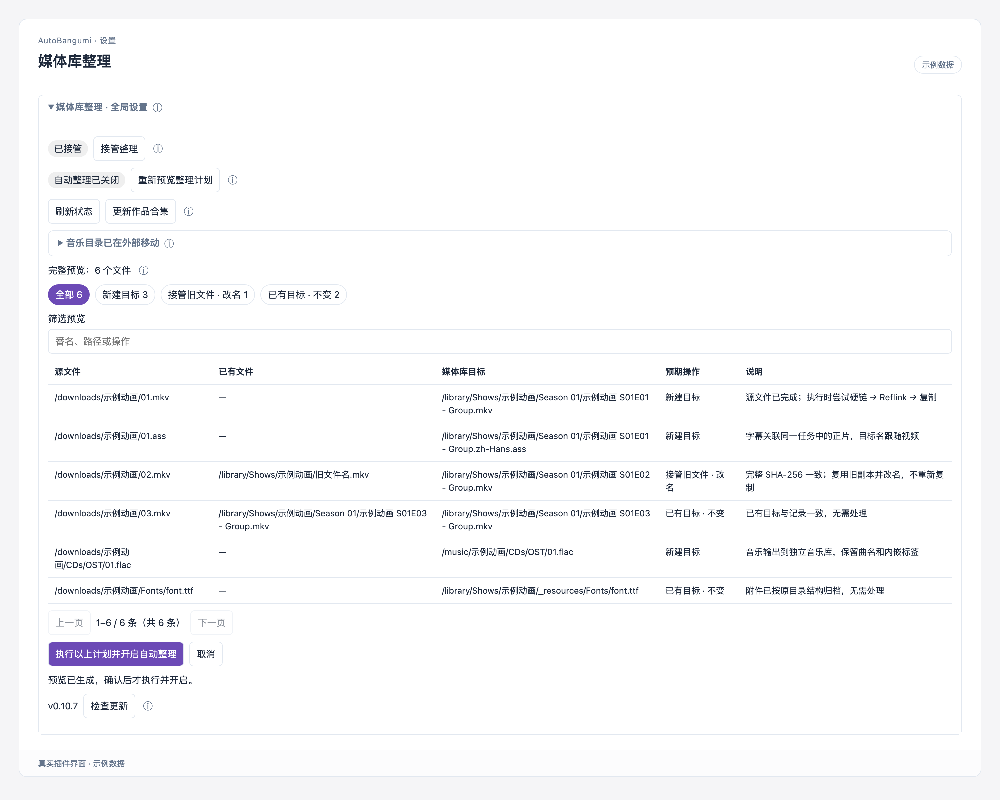

# AutoBangumi 媒体库整理

为 **AutoBangumi 4.0.0** 整理已有下载和后续新下载：保留下载原名，按 AB 元数据生成适合 Jellyfin 的媒体库文件。优先硬链接，其次 Reflink，最后普通复制；整理状态保存在插件自己的 SQLite 中。

[下载安装包](https://github.com/gregwym/autobangumi-library-organizer/releases/latest) · [使用与迁移](https://github.com/gregwym/autobangumi-library-organizer/blob/main/docs/USAGE.md) · [目录与合集](https://github.com/gregwym/autobangumi-library-organizer/blob/main/docs/LIBRARY_LAYOUT.md) · [AB API 提案](https://github.com/gregwym/autobangumi-library-organizer/blob/main/docs/UPSTREAM_API.md)



## 功能

- 默认沿用 AB 的标题、年份和季集偏移，无需逐番绑定；支持 TMDB 纠错和逐文件映射。
- 全局配置目录、命名模板和版本后缀；单番设置放在番剧详情的「媒体库」页。
- 正片、字幕、外挂音轨、特典、音乐和附件分别处理。音乐库可选，未配置时先归档。
- 启用自动整理前提供完整预览，按操作筛选，显示源路径、已有文件、目标及核验结果。
- 核验并复用旧媒体库副本，改名时不重复复制；支持音乐目录外部移动后的路径记录更新。
- 可生成文件驱动的作品合集，关联已整理的动画和专辑，无需 Jellyfin API 凭据。
- 新集和电影正片校验并入库后发送 AB 站内通知，重启及重复扫描不重复提醒。
- 媒体库文件或合集清单发生变化后，交由 AB 的「媒体库刷新」插件刷新。服务器配置沿用该插件的设置。
- 操作日志记录扫描、文件写入、维护与更新；无变化的周期检查每小时留一条摘要。
- 自动检查新版，点击一次更新；不会自动安装。

## 安装

兼容 **AB 4.0.0 + qBittorrent**。当前版本使用 AB 内部接口兼容层，不能视为跨版本通用插件；升级 AB 前需核对兼容性。

1. 下载 Release 中的 `library-organizer-<version>.zip`，解压到 `config/plugins/local/library-organizer/`，使该目录直接包含 `plugin.toml`。
2. 在 AB 中允许未签名本地插件，启用插件并重启 AB。
3. 在插件选项中填写 AB 容器内的下载根目录、媒体库根目录及必要的下载器路径映射。默认分别为 `/downloads`、`/library`，两者不能重叠。
4. 到「设置 → 媒体库整理」点击「接管整理」。插件会备份配置并关闭原生重命名、内置硬链；这一步不处理媒体文件。
5. 点击「预览并开启自动整理」，检查完整计划，再点击「执行以上计划并开启自动整理」。之后每分钟检查新下载。也可在单番详情手动预览和执行。

首次预览包含已有的完成下载。取消、过期或执行失败时，自动整理保持关闭。Jellyfin 仍需自行扫描媒体目录；文件整理完成与识别完成是两个状态。

## 文件与状态

| 操作 | 行为 |
| --- | --- |
| 新建媒体库文件 | 硬链接 → Reflink → 普通复制，记录实际方式；普通复制额外占用空间 |
| 旧副本改名 | 核验后在媒体库内移动，不重新复制；目标冲突时保留原文件 |
| 重复扫描 | 已有目标不重复复制；用户手动删除的成功目标不自动重建，可手动补整理 |
| 任务归属不明、文件不可读 | 保持待确认，不猜测归属，不把权限错误当作文件不存在 |
| 停用或卸载 | 保留媒体和记录，不自动恢复原生重命名；恢复方法见[使用说明](https://github.com/gregwym/autobangumi-library-organizer/blob/main/docs/USAGE.md#停用与恢复) |

每次单番整理只处理该 AB 条目关联的任务。不同条目可输出到同一作品目录。默认版本后缀使用字幕组／压制组名，多集发布另加「合集」，同组的单集和合集可以并存。目标重名时暂停对应文件。qB 任务和源文件保留原状。

## 限制

- 需要下载任务与 AB 条目有可靠关联；未关联任务需确认。多集单文件、歧义集号和部分特别篇需逐文件指定。
- 不生成音视频 NFO、改写音乐标签、切轨、解压或转码。字体、扫描图及无法安全分类的附件按原结构归档。
- 不创建容器挂载或 Jellyfin 媒体库。合集依赖服务器的本地 XML 扫描，展示与删除限制见[目录说明](https://github.com/gregwym/autobangumi-library-organizer/blob/main/docs/LIBRARY_LAYOUT.md)。
- 使用硬链接的源与目标共享内容；插件不修改内容。权限、磁盘满和 I/O 错误会停止相关操作。

## 更新与备份

插件启动约一分钟后、此后每六小时检查本仓库的稳定 Release。在设置中点击更新，校验 ZIP 身份和 SHA-256，备份数据库及旧代码后重载。仍需允许未签名插件；校验和不等于官方签名。

加载失败自动恢复旧代码，数据库备份保留供人工恢复。更新中断及备份位置见[使用说明](https://github.com/gregwym/autobangumi-library-organizer/blob/main/docs/USAGE.md#更新与数据)。提交问题时请去掉日志中的私人路径、站点令牌和凭据，不要上传数据库或配置备份。

<details>
<summary>开发与测试</summary>

Python 3.14；CI 固定验证 AB 4.0.0 的 `bc23984ae4a6d388c0b8381e48f6aa9b60e338ba`。

```sh
AB_SOURCE=/path/to/Auto_Bangumi /path/to/Auto_Bangumi/backend/.venv/bin/python -m pytest -q
/path/to/Auto_Bangumi/backend/.venv/bin/ruff check .
/path/to/Auto_Bangumi/backend/.venv/bin/ruff format --check .
PYTHONPATH=/path/to/Auto_Bangumi/backend/src /path/to/Auto_Bangumi/backend/.venv/bin/ab-plugin validate .
python3 tools/build.py
```

Release 安装包按允许列表构建，不包含运行数据。发布 `vX.Y.Z` 标签，CI 通过后生成 ZIP 和 SHA-256。

</details>

This product uses the TMDB API but is not endorsed or certified by TMDB.
